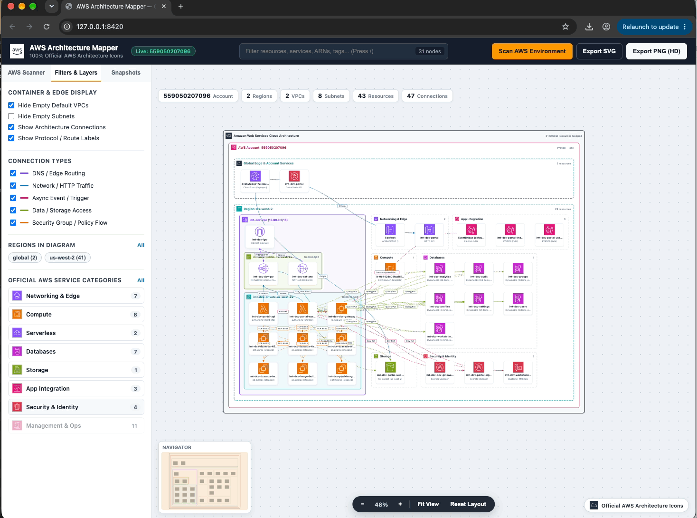

# AWS Architecture Mapper

An interactive local web application (plus headless CLI) that scans your entire AWS environment across local `~/.aws` profiles & SSO sessions and builds hierarchical architecture diagrams using **100% official Amazon Web Services Architecture Icons** (`assets/aws-icons/`, official July 2026 release).



## Highlights

- **100% Official AWS Icons Only**: Bundles 810 genuine SVG icons from the official AWS Architecture Asset Package — Service icons (`Arch_*_64.svg`), Resource icons (`Res_*_48.svg`), Category icons (`Arch-Category_*_64.svg`), and AWS Group boundary icons (`AWS-Cloud-logo_32.svg`, `AWS-Account_32.svg`, `Region_32.svg`, `Virtual-private-cloud-VPC_32.svg`, `Public-subnet_32.svg`, `Private-subnet_32.svg`, `Auto-Scaling-group_32.svg`).
- **Deep Read-Only Multi-Region AWS Discovery**:
  - **Global Edge**: Route 53 Hosted Zones & Alias records, CloudFront Distributions & Origins, Global WAFv2, S3 Buckets (mapped automatically to their home regions).
  - **VPC & Network Topology**: VPCs, Route Tables (automatic **Public vs. Private Subnet** classification via `igw-*` route inspection), Internet Gateways, NAT Gateways, Gateway & Interface VPC Endpoints, Transit Gateways, VPC Peering, Security Groups.
  - **Compute & Containers**: EC2 Instances, Auto Scaling Groups, ECS Clusters & Fargate/EC2 Services, EKS Clusters, ECR Repositories, ALB / NLB / GWLB Load Balancers & Target Groups.
  - **Serverless, APIs & Messaging**: Lambda Functions (VPC & regional) + Event Source Mappings, API Gateway (REST v1 & HTTP/WebSocket v2), SQS Queues, SNS Topics & Subscriptions, EventBridge Buses & Rules, Step Functions.
  - **Databases, Analytics & Security**: Aurora Clusters, RDS Instances, DynamoDB Tables, ElastiCache Clusters, OpenSearch, Kinesis, EFS, Secrets Manager, Customer KMS Keys, Regional WAFv2, plus a **Universal Resource Groups Tagging API Sweep** across 200+ AWS services.
- **Automatic Relationship Inference**: Synthesizes traffic, DNS routing, event triggers, S3/DDB endpoint access, and Security-Group-to-Security-Group tier flows.
- **Interactive Web Canvas + Standalone SVG & HD PNG Export**:
  - Pan, cursor-centered zoom, minimap navigation, draggable resource cards, hover connection tracing, click-to-inspect ARN/metadata drawer, and live filters.
  - Exports **100% standalone SVG** (with official AWS SVGs embedded inline) and **high-DPI Retina PNG**.

---

## Quick Start (Interactive Web App)

```bash
cd /Users/dzavada/.gemini/antigravity/scratch/aws-arch-mapper
python3 app.py
```

This starts the local studio at `http://127.0.0.1:8420` and opens it in your browser.

1. If using **AWS SSO**, ensure your session is active first:
   ```bash
   aws sso login --profile your-profile-name
   ```
2. In the left **AWS Scanner** panel, pick your `~/.aws` profile, choose **All Enabled Regions** (or select specific regions), and click **Start Live AWS Scan**.
3. Explore, drag nodes if desired, filter by region or official AWS category, and click **Export SVG** or **Export PNG (HD)**.

---

## Headless CLI Mode

Generate standalone SVG, PNG, and JSON snapshots directly from the terminal:

```bash
# Scan all enabled regions for a local ~/.aws profile
python3 app.py --cli --profile default --output-svg my-aws.svg --output-png my-aws.png --output-json my-aws.json

# Scan specific regions only
python3 app.py --cli --profile prod-sso --regions us-east-1,us-west-2 --output-svg prod-arch.svg

# Test CLI output using the built-in multi-region sample topology
python3 app.py --cli --sample --output-svg sample-arch.svg --output-png sample-arch.png
```

